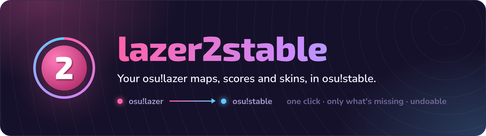
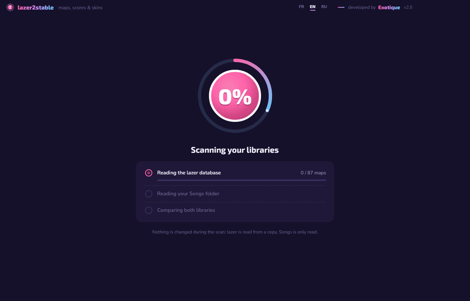
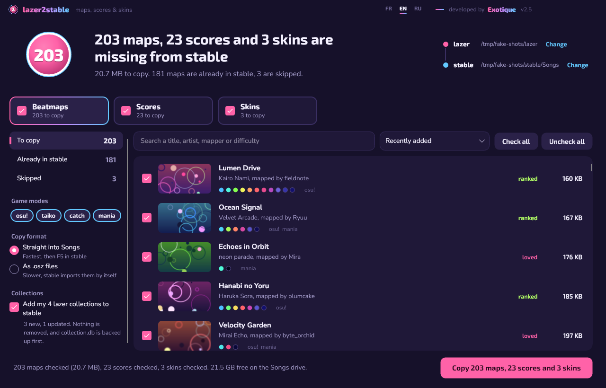
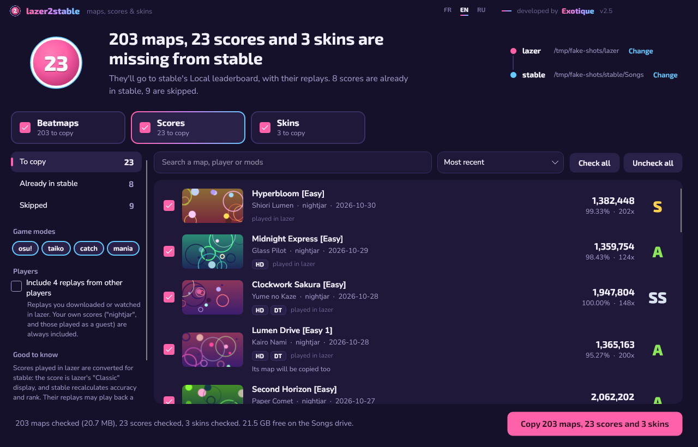
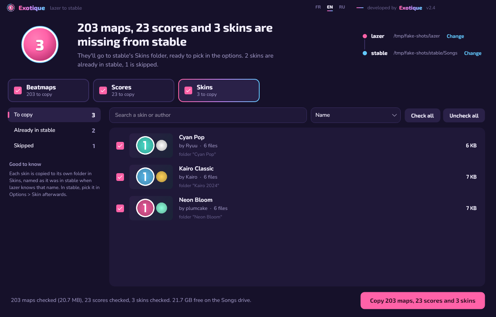
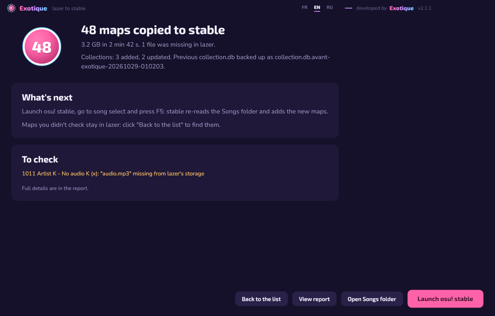

  

  

  
  
  
  
  

  <a href="#quick-start">Quick start</a> ·
  <a href="#what-gets-copied">What gets copied</a> ·
  <a href="#your-data-is-safe">Safety</a> ·
  <a href="#faq">FAQ</a> ·
  <a href="#français">Français</a> ·
  <a href="#русский">Русский</a>

 

  

## Why

You play on lazer now. You downloaded hundreds of maps there, set scores, collected skins. Then you open osu!stable and none of it is there.

lazer can import *from* stable, but not the other way round. **lazer2stable compares both libraries and copies everything stable is missing in one go**: maps, collections, scores with their replays, and skins. It never touches lazer, and you can undo the copy afterwards.

> [!TIP]
> Want to export your whole library as `.osz` or `.mp3` files instead? [BeatmapExporter](https://github.com/kabiiQ/BeatmapExporter) is great for that. If you play on both clients and want stable to stay up to date, with your scores in its leaderboard, you're in the right place.

## Quick start

1. **[Download `lazer2stable.exe`](https://github.com/exotiquepy/lazer2stable/releases/latest/download/lazer2stable.exe)** and run it. Nothing to install.
2. It finds your lazer and stable folders on its own and scans both. Review the lists and uncheck anything you don't want.
3. Click **Copy**. Then in osu!stable, go to song select and press **F5**.

That's it. Your scores are in the **Local** leaderboard and your skins in **Options › Skin**.

> [!NOTE]
> The exe isn't code-signed yet, so Windows may say *"Windows protected your PC"*. Click **More info**, then **Run anyway**. Each release lists the file's SHA-256 if you want to check it.

## What gets copied

<table>
  <tr>
    <td width="50%"></td>
    <td width="50%"></td>
  </tr>
  <tr>
    <td width="50%"></td>
    <td width="50%"></td>
  </tr>
</table>

| | Goes to | Counted as already in stable when… |
|---|---|---|
| 🎵 **Beatmaps** | `Songs\123456 Artist - Title`, or `.osz` files stable imports on startup | Songs has the same set ID, the same difficulty ID, or an identical `.osu` file (even inside an `.osz` stable hasn't imported yet) |
| 📁 **Collections** | merged into `collection.db` | a collection with the same name exists: it gets the missing maps, nothing is removed |
| 🏆 **Scores** | `scores.db` (Local leaderboard) + replays in `Data\r` | the same replay or the same play is already there |
| 🎨 **Skins** | `Skins\<name>`, one folder per skin | a skin with the same folder name or the same `skin.ini` exists |

Each part has its own checkbox. Already have your maps in stable? Uncheck **Beatmaps** and copy only your scores. Want only skins? Same idea.

**A few things stay in lazer**, because stable can't read them. The app shows each one with the reason:

- maps edited in the lazer editor (saved in a format stable can't open; use the editor's stable-compatible export),
- custom game modes,
- scores with lazer-only mods, or mods set differently than stable allows (DT at 1.3x, for example),
- skins made in lazer's skin editor (argon, triangles),
- replays of other players you watched in lazer, unless you tick **Include replays from other players**.

## Your data is safe

- **lazer is never modified.** Its database is read from a temporary copy.
- **Nothing in stable is removed or overwritten.** `scores.db` and `collection.db` are backed up next to the original before every change.
- **No half-copied maps.** Each map is written to a temporary folder, then moved into Songs. You can stop at any time.
- **Undo the last copy** in one click. It removes exactly what that copy added: maps and skins go to the Recycle Bin, and anything you did in stable since then is kept.
- **osu! open?** lazer2stable notices and offers to close it properly first, so stable doesn't overwrite the new scores and collections when it quits.
- **Offline.** It sends nothing anywhere and collects no data.

## FAQ

<b>Will my lazer scores give me pp or show up online?</b>

 
No. They go to stable's <b>Local</b> leaderboard only, nothing is submitted. Scores you played in lazer are converted: the score is lazer's "Classic" value and stable recalculates accuracy and rank. Their replays may play back slightly differently in stable, because lazer judges sliders differently.

<b>Can I run it again later?</b>

 
Yes, as often as you like. Each run only copies what's new since last time.

<b>My lazer or stable is in a custom folder.</b>

 
lazer2stable follows lazer's custom storage location (<code>storage.ini</code>) and stable's <code>BeatmapDirectory</code> setting. If it still can't find a folder, click <b>Change</b> and pick it.

<b>A score was skipped. Why?</b>

 
Open the <b>Skipped</b> tab of the Scores list: each score shows its reason. Usually the map isn't in stable and can't be copied (edited in lazer, or stable has another version of it), or the score uses mods stable doesn't have.

<b>I copied by mistake.</b>

 
Click <b>Undo the last copy</b> at the top of the list or on the summary screen. Maps and skins go to the Recycle Bin, and the added scores and collection entries are taken back out.

<b>Where are my settings and reports?</b>

 
Settings: <code>%APPDATA%\lazer2stable</code>. A report of every copy and the undo record: <code>%LOCALAPPDATA%\lazer2stable</code>. Nothing is stored anywhere else.

<b>Something went wrong.</b>

 
<a href="https://github.com/exotiquepy/lazer2stable/issues/new">Open an issue</a> with what you did and the error text. If the app showed an error file, attach it.

## Français

**lazer2stable copie vers osu!stable tout ce que lazer a et que stable n'a pas** : maps, collections, scores avec leurs replays, et skins. lazer n'est jamais modifié, rien n'est supprimé dans stable, `scores.db` et `collection.db` sont sauvegardés avant chaque modification, et **Annuler la dernière copie** retire exactement ce qui a été ajouté.

[Télécharge `lazer2stable.exe`](https://github.com/exotiquepy/lazer2stable/releases/latest/download/lazer2stable.exe), lance-le, décoche ce que tu ne veux pas, clique sur **Copier**, puis appuie sur **F5** dans la sélection des musiques de stable. Tes maps déjà dans stable ? Décoche **Beatmaps** pour ne copier que les scores. L'interface est en français si Windows l'est ; sinon, choisis **FR** dans la barre de titre.

## Русский

**lazer2stable копирует в osu!stable всё, что есть в lazer, но нет в stable**: карты, коллекции, рекорды с реплеями и скины. lazer никогда не изменяется, в stable ничего не удаляется, `scores.db` и `collection.db` сохраняются перед каждым изменением, а **Отменить последнее копирование** убирает ровно то, что было добавлено.

[Скачай `lazer2stable.exe`](https://github.com/exotiquepy/lazer2stable/releases/latest/download/lazer2stable.exe), запусти, сними отметки с ненужного, нажми **Скопировать**, затем **F5** в меню выбора песен stable. Карты уже в stable? Сними отметку с **Карты**, чтобы скопировать только рекорды. Интерфейс на русском, если Windows на русском; иначе выбери **RU** в заголовке окна.

## Contributing

Bug reports, translations and pull requests are welcome. See [CONTRIBUTING.md](CONTRIBUTING.md) to build it, run the tests and add a language.

## License

[MIT](LICENSE) © Exotique. Built with [Avalonia](https://avaloniaui.net), [Realm](https://github.com/realm/realm-dotnet) and [CommunityToolkit.Mvvm](https://github.com/CommunityToolkit/dotnet), see [THIRD-PARTY-NOTICES.md](THIRD-PARTY-NOTICES.md).

osu! is a trademark of ppy Pty Ltd. lazer2stable is an independent community tool, not affiliated with or endorsed by ppy.
