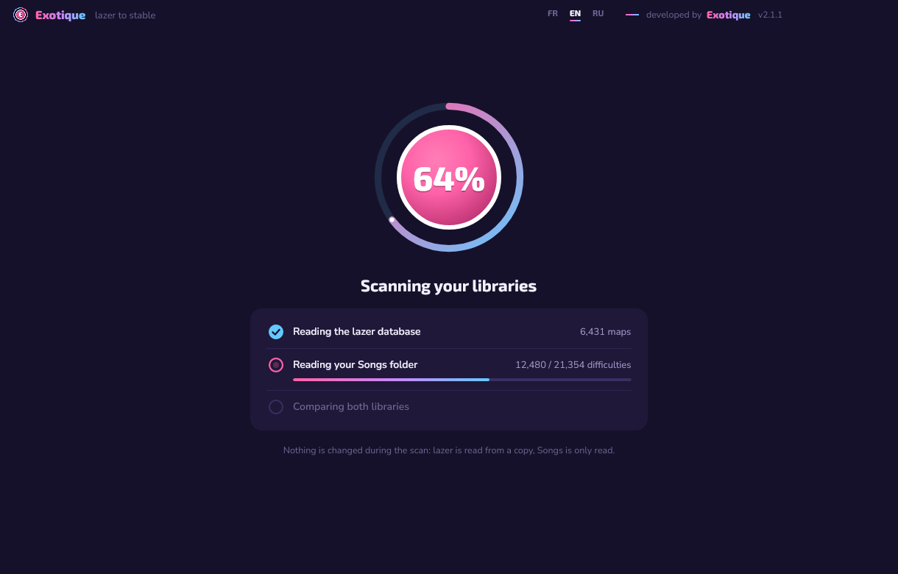

<p align="center"></p>

<h1 align="center">Exotique</h1>

<p align="center">Copy the beatmaps you have in <b>osu!lazer</b> to <b>osu!stable</b>, only the ones stable doesn't have yet.<br>
Windows · English / Français / Русский · developed by Exotique</p>

<p align="center"></p>

## Download and use

1. Download `Exotique.exe` from the [Releases](../../releases) page. Nothing to install.
   The exe isn't code-signed, so Windows may show "Windows protected your PC": click **More info**, then **Run anyway**.
2. Launch it. Exotique finds your lazer and stable folders and scans both libraries. You can change either folder with **Change**.
3. Review the list: uncheck what you don't want, then click **Copy … maps to stable** and confirm.
4. Launch osu!stable, go to song select and press **F5**: stable re-reads the Songs folder and adds the new maps.
   (With the `.osz` format, stable imports them by itself on startup, no F5 needed.)

If osu! is open, Exotique tells you and can close it for you before copying. The interface follows your Windows language; switch with **FR / EN / RU** in the title bar.

## What it does

- **lazer is never modified.** Its database (`client.realm`) is read from a temporary copy.
- **Only missing maps are copied.** A map counts as already in stable when Songs has the same set ID, the same difficulty ID, or an identical `.osu` file, including in an `.osz` that stable hasn't imported yet.
- **Safe copies.** Maps are written to a temporary folder and then moved into Songs (as `123456 Artist - Title`), so a stopped copy never leaves a half-copied map. You can stop at any time.
- **Collections (optional).** Your lazer collections are merged into stable's `collection.db`: collections with the same name get the missing maps, nothing is removed, and the previous file is backed up next to it (`collection.db.avant-exotique-…`).
- **A report** of every copy is written to `%LOCALAPPDATA%\Exotique\rapports`. Your folder choices and language are remembered in `%APPDATA%\Exotique`.

<p align="center"> </p>

## Skipped maps

- **Edited in the lazer editor.** lazer saves them in a format (`v128`) that stable can't read. Export them from the lazer editor with the stable-compatible export.
- **lazer-only game modes** (custom rulesets): stable can't play them.
- **Deleted or built-in lazer content**: never shown.

## Build from source

Requires the .NET 8 SDK.

```
dotnet publish Exotique.csproj -c Release -r win-x64 --self-contained -p:PublishSingleFile=true -p:IncludeNativeLibrariesForSelfExtract=true -p:EnableCompressionInSingleFile=true -p:DebugType=none -o publish
```

Exotique reads lazer's database with the same Realm version as lazer (`RealmVersion` in `Exotique.csproj`). If lazer ever moves to a newer Realm, align it with `osu.Game/osu.Game.csproj` in [ppy/osu](https://github.com/ppy/osu).

### Project layout

| Folder | Content |
|---|---|
| `src/Core` | Reading lazer (Realm), scanning Songs, comparing, copying, `collection.db`, translations (`Strings.cs`) |
| `src/App` | Avalonia interface |
| `tests/FakeLibrary` | Generates a fake lazer library + stable Songs folder covering edge cases |
| `tests/Screens` | Renders every screen to PNG in each language, and runs a full copy (`e2e`) headless |
| `tests/RealDbCheck` | Reads a real lazer database and prints a summary |

### Translations

All texts are in `src/Core/Strings.cs`, one line per text with the French, English and Russian versions. Plurals use `|` between forms (singular|plural, or 1|2-4|5+ in Russian). To add a language, add a value to `Lang` in `Loc.cs` and a column in `Strings.cs`.

## Français

Exotique copie vers osu!stable les beatmaps de osu!lazer qu'il n'a pas encore. lazer n'est jamais modifié, seules les maps absentes de stable sont copiées, et tes collections peuvent être ajoutées (l'ancien `collection.db` est sauvegardé). Après la copie, appuie sur **F5** dans la sélection des musiques de stable. L'interface est en français si Windows l'est ; sinon, choisis **FR** dans la barre de titre.

## Русский

Exotique копирует в osu!stable карты из osu!lazer, которых там ещё нет. lazer никогда не изменяется, копируются только недостающие карты, а коллекции можно добавить (старый `collection.db` сохраняется). После копирования нажми **F5** в меню выбора песен в stable. Интерфейс на русском, если Windows на русском; иначе выбери **RU** в заголовке окна.

## Credits and license

Developed by **Exotique**, released under the [MIT license](LICENSE). Built with Avalonia, Realm and CommunityToolkit.Mvvm, see [THIRD-PARTY-NOTICES.md](THIRD-PARTY-NOTICES.md).

osu! is a trademark of ppy Pty Ltd. Exotique is an independent community tool, not affiliated with or endorsed by ppy.
